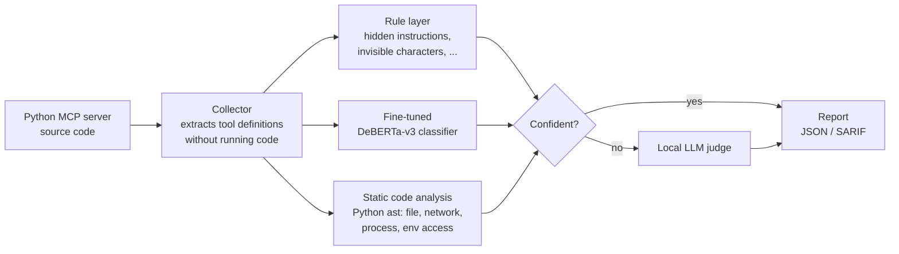

# MCP Tool Poisoning Detection Scanner

> 🚧 **Work in progress:** graduation project and TÜBİTAK 2209-A research proposal (2026–2027). Code is being added step by step.

A fully local hybrid scanner that detects **tool poisoning** in [Model Context Protocol (MCP)](https://modelcontextprotocol.io) servers before they are installed. No code or tool definitions are sent to external services.

## The Problem

MCP lets AI models connect to external tools such as file systems, email or databases. A model decides which tool to use by reading the tool's **name and description**. An attacker can hide instructions inside these descriptions, invisible to the user, and make the model leak sensitive files (for example SSH keys) or misuse other tools. This attack is called **tool poisoning**, a form of indirect prompt injection.

Existing scanners usually rely on cloud LLM APIs by default, which means sharing tool definitions with a third party, and their reported precision on real-world servers is limited.

## Approach

The scanner combines cheap, explainable checks with heavier models only where needed:

- **Rule layer:** fast, explainable checks applied to every tool.
- **Classifier:** a fine-tuned DeBERTa-v3 model applied to every tool.
- **Code–description consistency:** static analysis with Python's `ast` module finds what a tool actually does (file, network, process and environment variable access) and compares it with what its description says. No LLM is required for this step.
- **Local LLM judge:** only the uncertain cases are sent to a quantized open-weight model running locally.

**Scope:** MCP servers written in Python.

## Status

- [x] Collector (first version): extracts tool definitions from MCP server source code
- [x] 300 open-source Python MCP servers collected
- [x] Rule-based detection layer (alpha)
- [ ] Labeled dataset (3,000+ samples, two independent annotators)
- [ ] Static code analysis module
- [ ] Fine-tuned DeBERTa-v3 classifier
- [ ] Local LLM judge and cascade
- [ ] Comparative evaluation against existing scanners
- [ ] Command-line tool with JSON and SARIF output

## Research Context

This repository is part of a Computer Engineering graduation project at Adana Alparslan Türkeş Science and Technology University and of a **TÜBİTAK 2209-A** undergraduate research proposal:

*"MCP Sunucularında Araç Zehirlenmesinin Yerel Hibrit Tarayıcıyla Tespiti"*
*(Detecting Tool Poisoning in MCP Servers with a Local Hybrid Scanner)*

- **Author:** Ahmet Çetin
- **Advisor:** Dr. Öğr. Üyesi Mehmet Kurucan

## Responsible Use

This project is for defensive security research. Findings about public servers will be manually verified and reported to their maintainers before any public disclosure.
